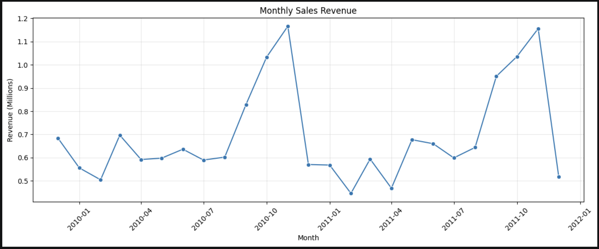
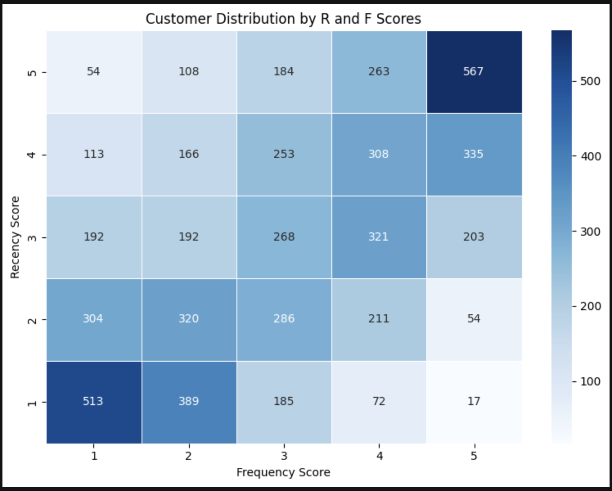
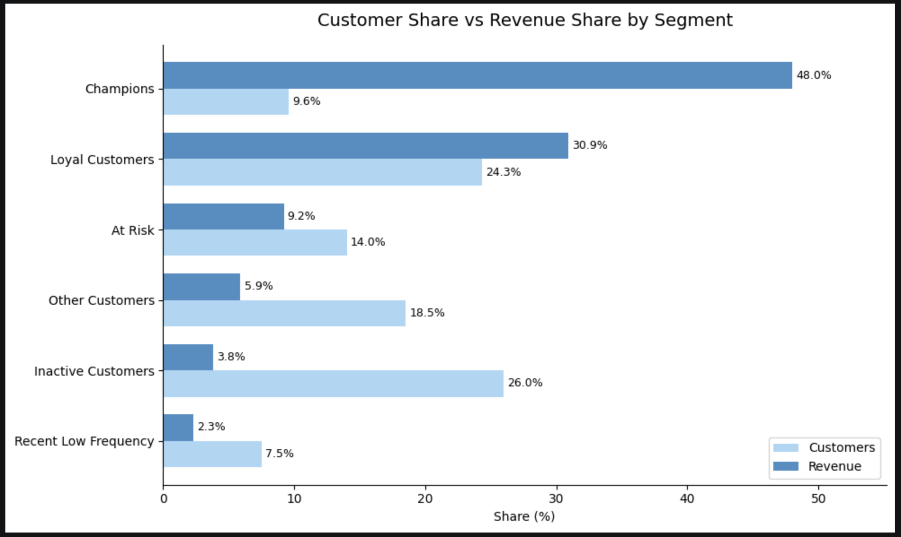

# Online Retail Sales Analysis & Customer Segmentation

A Python data analysis project exploring online retail transactions from 2009 to 2011. The goal is to understand sales trends and group customers based on their purchasing behavior using **RFM analysis**.

## Project Overview

This project focuses on three questions:

- How does sales revenue change over time?
- How can customers be grouped based on their purchase history?
- Which customer segments contribute the most revenue?

## Tools & Libraries

- **Python** – Data analysis
- **Pandas** – Data cleaning and transformation
- **Matplotlib & Seaborn** – Data visualization

## Dataset

The project uses the **Online Retail II** dataset, which contains transaction records from a UK-based online retailer.

The dataset includes:
- Invoice number and date
- Product code and description
- Quantity and unit price
- Customer ID
- Country

The two yearly sheets are combined into one dataset for analysis.

## Analysis Steps

### 1. Data exploration and cleaning

- Combine the two yearly datasets.
- Inspect data types and column information.
- Check missing values and duplicate records.
- Explore invalid transactions and unusual values.

### 2. Data Cleaning
- Remove records with missing Customer IDs.
- Exclude canceled transactions and invalid quantities or prices.
- Remove duplicate records.
- Prepare the cleaned dataset for further analysis.

### 3. Sales analysis

- Calculate revenue as `Quantity × Price`.
- Aggregate revenue by month.
- Visualize monthly revenue trends.

### 4. RFM analysis

Calculate three metrics for each customer:

| Metric | Meaning |
| --- | --- |
| **Recency (R)** | Days since the customer's latest purchase |
| **Frequency (F)** | Number of unique invoices |
| **Monetary (M)** | Total revenue from the customer's purchases |

Each metric is scored from 1 to 5. Customers are then assigned to six groups using their Recency and Frequency scores: **Champions, Loyal Customers, At Risk, Inactive, Recent Low Frequency, and Other**.

## Data Visualizations

### 1. Monthly Sales Revenue

Monthly revenue trends from 2009 to 2011.



### 2. Customer Distribution by R and F Scores

Heatmap showing customer distribution based on Recency and Frequency scores.



### 3. Customer Share vs Revenue Share

Comparison of customer share and revenue contribution across customer segments.


## Key Findings

- The analysis identifies **5,878 customers** for RFM segmentation.
- **Champions** represent approximately 9.6% of customers but contribute around 48% of total revenue.
- **Loyal customers** contribute approximately 30.9% of total revenue.
- Champions and Loyal customers together generate a large share of total revenue.
- The results can support customer retention strategies.

## Project Structure

```text
online-retail-customer-segmentation/
├── notebook/
│   └── analysis.ipynb
├── data/
│   └── online_retail_II.xlsx   
├── chart/                       
├── .gitignore
└── README.md
```


## Limitations

- The analysis excludes returns, non-positive transactions, and records without customer IDs. Therefore, the revenue shown is **positive sales revenue**, not net revenue after returns.
- RFM segments are based on simple rules and are not predictions of future customer behavior.
- The scoring uses ranked values to create five groups; customers with the same original metric may receive different scores when ties are broken.
- The first and last months of the dataset may be incomplete, so monthly comparisons require care.

## What I Learned

Through this project, I practiced checking data quality, cleaning transaction records, creating business metrics, and using visualizations to communicate customer and sales insights.
